# Node + React + PostgreSQL — Production-Style Local Platform

A small full-stack app (React + Node.js/Express + PostgreSQL) taken step by
step into a production-style platform: containers, Kubernetes, an Ingress
API gateway, multi-environment CI/CD, platform services (Redis, queue, search,
read/write DB) and observability with autoscaling and rate limiting.

Everything runs **locally** (Docker + kind/minikube). Nothing here needs a cloud account.

> **Verification status — read this first.** Every file was written to be run, and
> I statically validated what could be validated offline (YAML lint, Compose
> parse, shell syntax, backend unit tests, frontend build). The environment this
> repo was authored in had **no Docker daemon and no Kubernetes cluster**, so the
> end-to-end runs and the screenshots in [`docs/`](docs/README.md) still need to be
> produced on a machine with Docker + kind. [`docs/README.md`](docs/README.md) lists
> the exact commands to capture each piece of evidence.

## Contents

1. [Repository layout](#repository-layout)
2. [Prerequisites](#prerequisites)
3. [Quick start (cheat sheet)](#quick-start-cheat-sheet)
4. [Architecture](#architecture)
5. [Task 1 — Docker Compose](#task-1--docker-compose)
6. [Task 2 — Kubernetes](#task-2--kubernetes-deployment)
7. [Task 3 — Ingress / gateway, DNS, debugging](#task-3--ingress--api-gateway--service-communication)
8. [Task 4 — CI/CD, secrets, rollback](#task-4--cicd--multi-environment-deployment)
9. [Task 5 — Redis, queue, search, read/write DB](#task-5--platform-services)
10. [Task 6 — Observability, scaling, rate limiting](#task-6--observability-scaling--rate-limiting)
11. [Design decisions, trade-offs, next steps](#design-decisions-trade-offs-and-what-i-would-do-with-more-time)

---

## Repository layout

```
.
├── Dockerfile.backend            # multi-stage, non-root, tini
├── Dockerfile.frontend           # multi-stage, unprivileged nginx
├── .dockerignore
├── docker-compose.yml            # one-command local stack (all services)
├── .env.example                  # compose overrides (copy to .env)
├── backend/                      # Express API + BullMQ worker + tests
├── frontend/                     # React (Vite) app + nginx.conf.template
├── k8s/                          # Kubernetes manifests (dev namespace)
├── observability/                # Prometheus, Grafana, Loki, Fluent Bit, dashboards
├── scripts/                      # kind-up/down, ingress, metrics-server, deploy, load-test
├── .github/workflows/ci-cd.yml   # test → build/push → deploy → rollback
├── docs/                         # diagrams + evidence (screenshots)
└── README.md
```

## Prerequisites

| Tool | Needed for | Notes |
|---|---|---|
| Docker (Engine or Desktop) with Compose v2 | Task 1+ | `docker compose version` |
| `kubectl` | Task 2+ | |
| `kind` **or** `minikube` | Task 2+ | kind is what the helper scripts use; minikube: start with `--cni=calico` so NetworkPolicies are enforced, then follow the manual steps in Task 2 |
| Node.js 20+ and npm | optional | only to run the backend/frontend/tests outside Docker |
| ~6 GB free RAM for Docker | Task 5–6 | OpenSearch + Prometheus + Loki + Grafana are the heavy ones |

## Quick start (cheat sheet)

```bash
# A) Docker Compose — one command
docker compose up --build                 # → http://localhost:8080

# B) Kubernetes on kind — one command (cluster, ingress, images, all manifests)
./scripts/kind-up.sh                      # → http://localhost:30080  (NodePort)
echo "127.0.0.1 node-react.local" | sudo tee -a /etc/hosts
                                          # → http://node-react.local (Ingress)

# C) Observability + autoscaling (after B)
./scripts/observability-up.sh             # → Grafana http://localhost:30300
./scripts/load-test.sh 120 20             # watch the HPA scale + dashboards react

# Tear down
docker compose down -v ; ./scripts/kind-down.sh
```

On Windows, edit `C:\Windows\System32\drivers\etc\hosts` (as Administrator) instead of `/etc/hosts`.

## Architecture

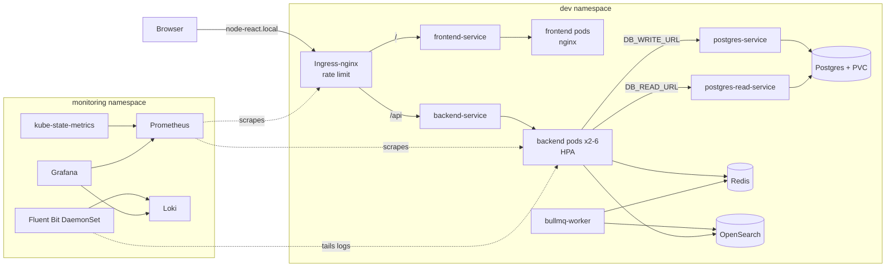

Only the **Ingress** (80) and Grafana's NodePort are reachable from the host. Postgres, Redis and
OpenSearch are `ClusterIP`-only *and* locked down with NetworkPolicies.

---

## Task 1 — Docker Compose

### Start (one command)

```bash
docker compose up --build
```

| What | URL |
|---|---|
| App (browser) | http://localhost:8080 |
| Backend API (direct, localhost only) | http://localhost:4000/api/health |
| PostgreSQL | not published to the host — `docker compose exec postgres psql -U appuser appdb` |

To override credentials or ports: `cp .env.example .env` and edit it. Stop with
`Ctrl+C`; `docker compose down` removes containers but **keeps the data**
(`docker compose down -v` also deletes the volume).

### What runs

```
browser ──► frontend (nginx :8080) ──/api/*──► backend (:4000) ──► postgres (:5432)
              edge network ───────────────────┘   └── data network (internal) ──┘
```

* **frontend** serves the Vite build and reverse-proxies `/api/*` to the
  backend, so the browser talks to a single origin.
* **backend** is the Express API. It creates its `items` table on boot and
  reads/writes Postgres.
* **postgres** stores data in the named volume `postgres_data`.
* **redis**, **search** (OpenSearch) and **worker** (BullMQ consumer) arrive in Task 5; they sit on the internal `data` network only and publish no host ports.

### Verify it works end to end

```bash
# 1. add an item through the frontend's origin (frontend -> backend -> postgres)
curl -s -X POST localhost:8080/api/items -H 'content-type: application/json' -d '{"name":"hello"}'
# 2. read it back
curl -s localhost:8080/api/items
# 3. prove persistence: recreate every container, data must still be there
docker compose down && docker compose up -d && curl -s localhost:8080/api/items
```

### Configuration (environment variables, no hard-coded secrets)

| Variable | Used by | Default (dev only) | Purpose |
|---|---|---|---|
| `DB_USER`, `DB_PASSWORD`, `DB_NAME` | postgres, backend | `appuser`, *dev placeholder*, `appdb` | database credentials |
| `DB_HOST`, `DB_PORT` | backend | `postgres`, `5432` | set in compose; the service name is the DNS name |
| `DB_WRITE_URL`, `DB_READ_URL` | backend | both → `postgres` | primary / replica connection strings (Task 5) |
| `REDIS_URL`, `SEARCH_URL` | backend, worker | `redis://redis:6379`, `http://search:9200` | platform services (Task 5) |
| `VITE_API_BASE_URL` | frontend (build arg) | `/api` | API base URL the browser uses |
| `BACKEND_URL` | frontend (runtime env) | `http://backend:4000` | where nginx proxies `/api/*` |
| `FRONTEND_PORT`, `BACKEND_PORT` | compose | `8080`, `4000` | published host ports |

Nothing secret is written into a Dockerfile or image layer. The `:-` defaults
in `docker-compose.yml` exist only so a bare `docker compose up` works on a
laptop; `.env` is git-ignored and excluded from build contexts, and Kubernetes /
CI inject credentials from Secrets (see Tasks 2 and 4).

### Dockerfile design notes

* **Multi-stage.** Backend: a `deps` stage runs `npm ci --omit=dev`, the runtime
  stage copies only `node_modules` + `src`. Frontend: a Node stage builds the
  bundle; the runtime image is just nginx + static files (no Node, no sources).
* **Layer caching.** `package*.json` are copied before the source, so a code
  change does not re-install dependencies. `npm` uses a BuildKit cache mount.
* **Small + safe base.** `node:20-alpine` and `nginx-unprivileged:alpine`; both
  containers run as non-root, backend uses `tini` as PID 1 for clean shutdowns.
* **One build context, two Dockerfiles.** The context is the repo root (so CI
  can use the same files); `.dockerignore` keeps it small and keeps `.env` out.
* **Same image, many roles.** The backend image also runs the queue worker
  (Task 5) with a different `command`.
* **Compose hardening.** `cap_drop: ALL`, `no-new-privileges`, healthchecks with
  `depends_on: condition: service_healthy`, and a split `edge`/`data` network:
  the frontend is not attached to the data network, which is `internal: true`.

---

## Task 2 — Kubernetes Deployment

Everything is in namespace **`dev`** (`k8s/namespace-dev.yaml`).

### Run it

```bash
./scripts/kind-up.sh      # creates the cluster if needed, builds + loads images, applies k8s/, waits for rollouts
kubectl -n dev get all    # evidence for docs/
```

Manual equivalent (kind or minikube):

```bash
kind create cluster --name node-react --config scripts/kind-config.yaml   # minikube: minikube start --cni=calico
./scripts/install-ingress.sh                                              # minikube: minikube addons enable ingress
docker build -f Dockerfile.backend  -t node-react-backend:local  .
docker build -f Dockerfile.frontend -t node-react-frontend:local .
kind load docker-image --name node-react node-react-backend:local node-react-frontend:local   # minikube: minikube image load ...
kubectl apply -f k8s/namespace-dev.yaml && kubectl apply -f k8s/
```

### What is in `k8s/`

| Area | Files | Notes |
|---|---|---|
| Namespace | `namespace-dev.yaml` | all resources live here |
| Backend | `backend-deployment.yaml`, `backend-service.yaml`, `backend-pdb.yaml`, `hpa-backend.yaml` | **ClusterIP**; PDB keeps ≥1 pod during drains |
| Frontend | `frontend-deployment.yaml`, `frontend-service.yaml` | **NodePort 30080** (external) |
| PostgreSQL | `postgres-deployment.yaml`, `postgres-service.yaml`, `postgres-read-service.yaml` | **ClusterIP**, `Recreate` strategy (RWO volume) |
| Storage | `postgres-pv.yaml`, `postgres-pvc.yaml` | PVC bound to a hostPath PV, `Retain` policy |
| Config | `app-configmap.yaml`, `app-secrets.yaml` | non-secret vs credentials |
| Gateway | `ingress-dev.yaml` | Task 3 |
| Platform | `redis-*`, `bullmq-worker-deployment.yaml`, `search-*`, `network-policies.yaml` | Task 5 |

### Internal vs external

| Service | Type | Reachable from |
|---|---|---|
| `frontend-service` | NodePort 30080 (+ Ingress) | outside the cluster |
| `backend-service`, `postgres-service`, `postgres-read-service`, `redis-service`, `search-service` | ClusterIP | in-cluster only |

### Probes (backend)

| Probe | Endpoint | Why |
|---|---|---|
| `startupProbe` | `/api/health/live` | tolerates a slow boot (up to 60 s) before liveness applies |
| `livenessProbe` | `/api/health/live` | process-only. It **does not check the DB** on purpose: a DB outage must not restart-loop every backend pod |
| `readinessProbe` | `/api/health/ready` | `SELECT 1` on the write pool; a pod that cannot reach the DB is removed from the Service endpoints instead of serving errors |

### Config and secrets

* `app-config` (ConfigMap): `DB_HOST`, `DB_PORT`, `DB_NAME`, `PORT`, `REDIS_URL`, `SEARCH_URL` — no credentials.
* `app-secrets` (Secret): `DB_USER`, `DB_PASSWORD`. The committed file contains **dev-only placeholders**; preprod/release get real values from GitHub Environment secrets (Task 4). Production should use Sealed Secrets / External Secrets / SOPS.
* `DB_WRITE_URL` / `DB_READ_URL` are assembled in the pod spec with `$(DB_USER)`/`$(DB_PASSWORD)` so the password never sits in a ConfigMap.

### Verify

```bash
kubectl -n dev get pods,svc,pvc
curl -s localhost:30080/api/health                                    # frontend nginx → backend-service
curl -s -X POST localhost:30080/api/items -H 'content-type: application/json' -d '{"name":"k8s"}'
kubectl -n dev delete pod -l app=postgres && sleep 20 && curl -s localhost:30080/api/items   # data survives (PVC)
```

---

## Task 3 — Ingress / API Gateway / Service Communication

* **Controller:** ingress-nginx (kind flavour), installed by `scripts/install-ingress.sh` (the kind node is labelled `ingress-ready=true` and maps host ports 80/443 — see `scripts/kind-config.yaml`).
* **Manifest:** `k8s/ingress-dev.yaml` — host `node-react.local`; `/api` → `backend-service:4000`, `/` → `frontend-service:80`. The longest matching prefix wins; no path rewrite is needed because the backend already serves under `/api`.
* **Hostname:** add `127.0.0.1  node-react.local` to your hosts file, then open <http://node-react.local>.

### 1. Full request path

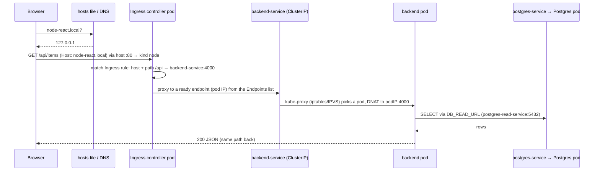

Step by step:

1. **Browser → Ingress.** The hosts file maps `node-react.local` to `127.0.0.1`; kind forwards host port 80 to the node, where the ingress-nginx controller pod listens (hostPort). The `Host` header selects the rule.
2. **Ingress → Service.** The controller does not use the Service's virtual IP for load balancing: it watches the Service's **Endpoints/EndpointSlices** and proxies straight to a ready pod IP (this is also why only *Ready* pods ever receive traffic). Rate limits (Task 6) are enforced here.
3. **Service → Pod.** A Service is a stable name + virtual IP + label selector. `kube-proxy` programs the node so traffic to the ClusterIP is DNAT-ed to one of the ready backend pods. A **Pod** is the thing that actually runs the container and has an ephemeral IP.
4. **Pod → PostgreSQL.** The backend resolves `postgres-service` (writes) / `postgres-read-service` (reads) through cluster DNS, connects to the Postgres pod, which stores data on the PVC.

Mental model: **Ingress** = L7 routing rules (host/path) at the edge · **Service** = stable internal address + load balancing over pods · **Pod** = the running workload.

For `/` the same path applies with `frontend-service` and the nginx pods; nginx additionally proxies `/api/*` to `backend-service.<ns>.svc.cluster.local`, which is what makes the NodePort (`:30080`) work without the Ingress.

### 2. How Kubernetes DNS resolves services

CoreDNS runs in `kube-system` and every pod's `/etc/resolv.conf` points at it, with search domains `<ns>.svc.cluster.local svc.cluster.local cluster.local`.

| Name used | Resolves because |
|---|---|
| `backend-service` | same namespace → first search domain `dev.svc.cluster.local` matches |
| `backend-service.dev` | cross-namespace form (`<svc>.<ns>`) |
| `backend-service.dev.svc.cluster.local` | fully-qualified; always unambiguous. Returns the Service **ClusterIP** (A record) |

```bash
kubectl -n dev run dns --rm -it --image=busybox:1.36 --restart=Never -- nslookup backend-service.dev.svc.cluster.local
```

The frontend uses the **FQDN** (`BACKEND_URL`) because nginx's resolver does not apply search domains. The namespace is injected with the Downward API (`POD_NAMESPACE`), so the *same manifest* works in dev, preprod and release.

### 3. Debugging scenarios

**(a) Ingress is reachable but the backend is not** (e.g. `502/503/404` from `node-react.local/api/...`, frontend loads fine). Work from the edge inward:

```bash
kubectl -n dev get ingress                                  # 1. rule exists? ADDRESS set? host/path correct?
kubectl -n dev describe ingress api-ingress                 #    "Backends" must show pod IPs, not <error: endpoints not found>
kubectl -n dev get endpoints backend-service                # 2. EMPTY endpoints = selector mismatch OR no Ready pods
kubectl -n dev get pods -l app=backend -o wide              # 3. Running? READY 1/1? restarts?
kubectl -n dev describe pod -l app=backend | tail -30       #    failing readiness probe / ImagePullBackOff / OOMKilled
kubectl -n dev logs deploy/backend --tail=50                #    app errors (DB down => readiness 503 => no endpoints)
kubectl -n dev port-forward svc/backend-service 4000:4000 & curl -i localhost:4000/api/health   # 4. bypass ingress: is the Service OK?
kubectl -n ingress-nginx logs deploy/ingress-nginx-controller --tail=50                        # 5. what did the gateway see/upstream?
```

Typical causes: Service `selector` ≠ pod labels (empty endpoints) · readiness probe failing because Postgres is down · wrong `targetPort`/port name · wrong `ingressClassName` (controller ignores the Ingress) · path/`pathType` typo · NetworkPolicy blocking the controller. The key discriminators: *404 from nginx* → no rule matched (host/path); *503* → rule matched but no ready endpoints; *502/504* → endpoint exists but the pod misbehaves/times out.

**(b) The frontend cannot talk to the backend** (page loads, API calls fail in the browser console).

```bash
# 1. What URL does the browser call, and what status? (DevTools → Network). /api (same origin) is expected.
curl -i http://node-react.local/api/health                 # via ingress
curl -i localhost:30080/api/health                         # via the frontend's own nginx proxy (NodePort)
# 2. From inside the frontend pod: can it resolve and reach the backend?
kubectl -n dev exec deploy/frontend -- env | grep BACKEND_URL
kubectl -n dev exec deploy/frontend -- wget -qO- http://backend-service.dev.svc.cluster.local:4000/api/health
kubectl -n dev run dns --rm -it --image=busybox:1.36 --restart=Never -- nslookup backend-service.dev.svc.cluster.local
# 3. Service has endpoints? NetworkPolicy in the way?
kubectl -n dev get endpoints backend-service ; kubectl -n dev get networkpolicy
kubectl -n dev logs deploy/frontend --tail=50              # nginx "connect() failed" / "could not be resolved"
```

Typical causes: wrong `BACKEND_URL` (typo / wrong namespace) · `VITE_API_BASE_URL` baked in at build time pointing somewhere unreachable from a *browser* (e.g. `http://backend:4000` — a cluster-internal name; the browser cannot resolve it — keep `/api`) · CORS if split-origin · DNS failure (CoreDNS down) · backend has no Ready pods. Remember the split: **the browser** calls the Ingress; **nginx in the pod** calls the backend through cluster DNS.

### 4. Evolving into microservices behind an API gateway

The Ingress is already the gateway: add one Service per backend and one path/host rule per service (`/api/users` → `users-service`, `/api/orders` → `orders-service`, `/api/search` → `search-service`). Each service gets its own Deployment, HPA, probes and — importantly — **its own database/schema** (no shared tables). Next steps: shared concerns (authN/JWT validation, rate limiting, request IDs) at the gateway — via ingress-nginx auth annotations, or move to **Gateway API** / Kong / Envoy for richer policy; async communication through the queue (BullMQ today, RabbitMQ/Kafka later) rather than synchronous call chains; a service mesh (Linkerd/Istio) for mTLS and per-hop retries/metrics once the service count justifies it; and contract tests + per-service CI pipelines (the path-filtered version of Task 4). The existing worker is already the first "second service": same repo, separately deployed and scaled.

---

## Task 4 — CI/CD & Multi-Environment Deployment

`.github/workflows/ci-cd.yml`

| Branch | Namespace | Image tag example |
|---|---|---|
| `master` | `dev` | `master-1a2b3c4` |
| `pre-release/v*` | `preprod` | `pre-release-v1.2.0-1a2b3c4` |
| `release/v*` | `release` | `release-v1.2.0-1a2b3c4` |

(`/` is replaced by `-` because it is illegal in image tags.)

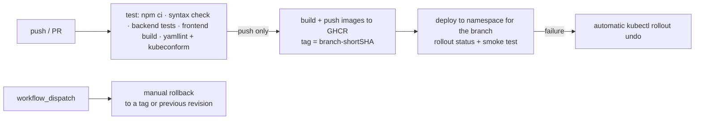

Stages: install deps (backend, frontend) → build/validate and **test** (4 backend tests run without any DB: health, validation, metrics) → manifest validation → build both Docker images (BuildKit + GHA layer cache) → push to **GHCR** → deploy via `scripts/deploy.sh`, which renders the manifests for the target environment (namespace, image tag, per-env PV name, Ingress host `node-react-<env>.local`), creates the DB Secret from CI secrets for non-dev environments, applies, waits for rollouts → smoke-tests `/api/health/ready` inside the backend pod.

### How CI secrets are stored and used

| Secret | Where | Used for |
|---|---|---|
| `GITHUB_TOKEN` | automatic, per-run, short-lived | login to GHCR (`packages: write` only on the build job). **No long-lived registry password exists** |
| `KUBECONFIG_B64` | GitHub **Environment** secret (`dev`, `preprod`, `release`), each with credentials for that environment only | decoded at deploy time into `~/.kube/config` (mode 0600), deleted in an `always()` step, never echoed |
| `DB_USER`, `DB_PASSWORD` | GitHub Environment secrets (required for preprod/release) | `deploy.sh` runs `kubectl create secret … --dry-run | apply`, so credentials never touch git or an image |

Practices: secrets are scoped per **Environment** (a `master` build can never read release credentials); the `release` Environment should have **required reviewers** (manual approval gate); deploy jobs use `concurrency` so two deploys to one namespace never interleave; workflow `permissions` default to read-only; secrets are passed through `env:` and never interpolated into shell text where avoidable; third-party actions are limited to official `actions/*` and `docker/*`. In production I would replace the long-lived kubeconfig with OIDC federation to the cluster, or switch to GitOps (Argo CD pulls from git, so CI needs no cluster credentials at all).

> **Local cluster caveat.** GitHub-hosted runners cannot reach a kind cluster on your laptop. Install a **self-hosted runner** on the machine running kind and set the repository variable `DEPLOY_RUNNER` to its label (the deploy/rollback jobs use `runs-on: ${{ vars.DEPLOY_RUNNER || 'ubuntu-latest' }}`). The `test` and `build-and-push` jobs work on hosted runners unchanged. For a throw-away demo, `kind-up.sh` + `scripts/deploy.sh` run the exact same deploy path by hand.

### Rollback strategy

1. **Automatic:** if `rollout status` or the smoke test fails, the deploy job runs `kubectl rollout undo` for backend and frontend (the Deployments use `maxUnavailable: 0`, so a bad version never took capacity away to begin with, and `revisionHistoryLimit: 5` keeps old ReplicaSets).
2. **Manual, fast:** `kubectl -n <ns> rollout undo deployment/backend` (or run the workflow via *Actions → Run workflow* with `rollback_namespace`).
3. **Manual, precise:** run the workflow with `rollback_namespace` **and** `rollback_tag` (e.g. `master-9f8e7d6`) → `kubectl set image` to a known-good tag that is still in GHCR. Tags are immutable-by-convention (branch + SHA), which is what makes this reliable — that is why the pipeline never deploys `:latest`.
4. `kubectl -n <ns> rollout history deployment/backend` shows the revisions; `--to-revision=N` rolls to a specific one.
5. Caveat: rollbacks revert *code*, not data. Schema changes must be backward compatible (expand → migrate → contract) so the previous version still works against the migrated DB.

---

## Task 5 — Platform Services

Added to **both** Docker Compose (`redis`, `search`, `worker`) and Kubernetes (`k8s/redis-*.yaml`, `bullmq-worker-deployment.yaml`, `search-*.yaml`, `postgres-read-service.yaml`, `network-policies.yaml`).

| Service | Choice | Wiring |
|---|---|---|
| Redis | `redis:7-alpine`, `noeviction` (required by BullMQ) | `REDIS_URL` → `redis-service:6379`; health: `GET /api/health/redis` |
| Queue | **BullMQ** on Redis; `bullmq-worker` Deployment (same image, `node src/worker.js`) | API enqueues `item-created` after every write; worker indexes the item into search |
| Search | **OpenSearch** 2.15, single node, security off (**dev only**) | `SEARCH_URL`; health: `GET /api/health/search`; search: `GET /api/search?q=…` (populated by the worker) |
| DB cluster simulation | two env vars + two Services | `DB_WRITE_URL` → `postgres-service`, `DB_READ_URL` → `postgres-read-service` |

```bash
kubectl -n dev port-forward svc/backend-service 4000:4000 &
curl localhost:4000/api/health/redis ; curl localhost:4000/api/health/search
curl -X POST localhost:4000/api/items -H 'content-type: application/json' -d '{"name":"kubernetes rocks"}'
kubectl -n dev logs deploy/bullmq-worker --tail=5          # "processing item-created" → "completed"
curl 'localhost:4000/api/search?q=kubernetes'              # found via OpenSearch
```

**Isolation / security.** Redis, OpenSearch and Postgres are `ClusterIP` only (no NodePort, no Ingress route, no published Compose ports; in Compose they live on the `internal: true` network). `network-policies.yaml` additionally allows ingress to Postgres only from `backend`, and to Redis/OpenSearch only from `backend` and `bullmq-worker` (needs a NetworkPolicy-enforcing CNI; kind's default does). In production these would also get authentication/TLS (Redis `AUTH`, OpenSearch security plugin) — they are off here purely because the services are unreachable from outside.

**Why these tools.** Redis = fast shared state (queue backend here; also cache, rate-limit counters, sessions). A **queue** decouples slow/failure-prone work from the request (the API answers 201 as soon as the row is committed; indexing happens asynchronously and is retried — at-least-once, so handlers must be idempotent: `indexItem` PUTs by id). **Search** is a denormalised secondary index optimised for full-text queries that Postgres does poorly at scale; it is *derived data*, rebuildable from the DB.

### Read/write DB routing and replication lag

**Where the routing logic lives.** Today: **in the application** — `backend/src/db.js` exposes `write()` (→ `DB_WRITE_URL`) and `read()` (→ `DB_READ_URL`) and each route chooses explicitly. That is the most precise option (the code knows which reads tolerate staleness) and needs no extra infrastructure. Alternatives: a **DB proxy** (PgBouncer + HAProxy, **pgpool-II**, **PgCat**, or RDS Proxy / cloud reader endpoints) that routes by statement type — transparent to the app, but it cannot know *which* reads need fresh data, so it needs hints or sticky sessions; or ORM-level routing (Rails/Django/Prisma read replicas). In Kubernetes a managed operator (CloudNativePG) publishes `-rw` and `-ro` Services that map one-to-one onto the two variables here, so going from simulation to a real replica is **configuration only**.

**What replication lag implies.** Replication from primary to replica is asynchronous, so a replica can be milliseconds to many seconds behind. A read from a replica may return *stale* data, and a read right after a write may not see that write (read-your-writes violation), or may see state that moves "backwards" between two requests hitting different replicas (non-monotonic reads).

**Must always hit the writer:**
* every `INSERT/UPDATE/DELETE`, DDL and migrations;
* **reads inside a write transaction** and read-modify-write sequences (`SELECT … FOR UPDATE`, counters, inventory/balance checks, uniqueness checks) — a stale read causes lost updates or double-spends;
* **read-your-own-write** paths: the response to a just-completed write, post-login/post-signup reads, "did my payment succeed", anything a user does immediately after changing it (`POST /api/items` returns the row from the writer for this reason);
* anything security-sensitive (permissions/roles/token revocation) where stale data is a vulnerability;
* **queue consumers** that react to a write (the worker's job for `item-created` must read from the writer or the payload — the replica may not have the row yet).

**Fine on a replica:** lists/feeds, dashboards, search-like queries, reports, anything where "a few seconds old" is acceptable. Mitigations: pin a user's reads to the primary for N seconds after they write; compare LSNs (`pg_last_wal_replay_lsn`) before reading; monitor `pg_stat_replication` lag and fail reads over to the primary when lag exceeds a budget; use synchronous replication only for data that truly cannot be stale (at a latency cost).

---

## Task 6 — Observability, Scaling & Rate Limiting

```bash
./scripts/observability-up.sh      # metrics-server + monitoring namespace + stack
kubectl -n monitoring get pods
```

| Component | File | Role |
|---|---|---|
| Prometheus | `observability/prometheus.yaml` | scrapes backend pods (annotation discovery, `/metrics`), the ingress controller (`:10254`), cAdvisor (CPU/memory via the API server) and kube-state-metrics; evaluates alert rules |
| kube-state-metrics | `observability/kube-state-metrics.yaml` | replica counts, HPA state, restarts, resource limits |
| Grafana | `observability/grafana.yaml` + `observability/dashboards/backend-overview.json` | provisioned datasources + dashboard; NodePort 30300; random admin password in a Secret |
| Fluent Bit | `observability/fluentbit-daemonset.yaml` | DaemonSet; tails `dev` + `ingress-nginx` container logs, adds k8s metadata, ships to Loki |
| Loki | `observability/loki.yaml` | log store (single binary, 24 h retention, emptyDir) |
| HPA | `k8s/hpa-backend.yaml` | autoscaling backend |

The backend exposes Prometheus metrics (`prom-client`): `http_requests_total{method,route,status}`, `http_request_duration_seconds` (histogram) plus default process/CPU/memory/event-loop metrics, and logs **one JSON line per request** (`{"level","msg":"request","method","path","status","duration_ms"}`). `/metrics` lives outside `/api`, so the Ingress never exposes it.

### Dashboard ("Backend overview")

CPU per pod (vs limit) · memory working set per pod (vs limit) · request rate by status · **error rate %** · **backend replicas over time** (current / available / HPA desired) · p50/p95 latency · gateway request rate incl. `429` · live Loki log panel. Open <http://localhost:30300> → *Node React → Backend overview*.

### Logging (Fluent Bit → Loki)

Open Grafana → **Explore → Loki** and try (labels: `app`, `tier`, `job`, `service_name`, `app_kubernetes_io_*`; the namespace and pod name are fields inside the JSON log line):

```logql
{app="backend"}                                  # all backend logs
{app="backend"} | json | status >= 500           # only server errors
{app="backend"} | json | path=~"/api/items.*" | duration_ms > 100   # slow item calls
{app="backend"} |= "redis"                       # free-text filter
sum by (status) (count_over_time({app="backend"} | json [1m]))   # logs → metric
```

Labels are low-cardinality by design (Loki indexes labels, not lines); fields like `status`/`path` are parsed at query time from the JSON log line.

### Alerts I would configure (rules are in `prometheus.yaml`)

Principle: **page on user-visible symptoms, ticket on causes/capacity**; every alert needs a `for:` window to avoid flapping and an owner who can act.

| Alert | Condition | Why |
|---|---|---|
| **High error rate** (page) | 5xx / total > 5 % for 5 m | direct user impact; the primary SLO signal. Also at the gateway (`IngressHigh5xx`) because it catches failures the app cannot report (no ready pods → 503) |
| **High latency** (ticket→page) | p95 > 500 ms for 10 m | slow = broken for users even when nothing errors; percentile, never the average |
| **Backend down** (page) | no scrapeable backend pod for 1 m | total outage |
| **Crash looping** (page) | > 3 restarts / 15 m | OOMKills or bad deploys; often precedes an outage |
| **High CPU** (ticket) | > 80 % of the CPU *limit* for 10 m | throttling → latency; capacity signal |
| **High memory** (ticket) | > 85 % of the memory limit for 10 m | OOMKill risk / leak |
| **HPA at max replicas** (ticket) | current == max for 15 m | the autoscaler has no headroom left; raise the ceiling or optimise |
| **Rate limiting active** (info) | > 1 req/s of `429` | abuse — or limits tuned too low and hurting real users |
| *(add in prod)* Postgres replication lag, queue depth/age, Redis memory, disk/PVC usage, certificate expiry | | the platform services from Task 5 |

Alertmanager (routing to Slack/PagerDuty, grouping, silences) is the one piece intentionally not deployed; the rules fire and are visible in Prometheus → *Alerts*.

### Autoscaling

`hpa-backend.yaml`: min **2** (HA + satisfies the PDB), max **6** (what a laptop node can schedule), target **60 % CPU of the request**. Scale up immediately (+2 pods / 30 s), scale down with a 120 s stabilisation window and −1 pod/min to avoid flapping. Requires CPU **requests** (set) and metrics-server (installed by `install-metrics-server.sh`, with `--kubelet-insecure-tls` for kind only). The Deployment omits `replicas:` so `kubectl apply` never fights the HPA.

```bash
./scripts/load-test.sh 180 20 &           # in-cluster load directly at backend-service
kubectl -n dev get hpa backend-hpa -w     # TARGETS climbs above 60 %, REPLICAS 2 → up to 6
```

### Rate limiting (at the Ingress)

Implemented with ingress-nginx annotations in `k8s/ingress-dev.yaml`, per client IP, returning **429** (`limit-req-status-code` set in the controller ConfigMap — the default `503` would look like an outage and pollute error-rate alerts):

| Path | Limit | Reasoning |
|---|---|---|
| `/api` | 10 req/s, burst ×3 (30), 20 concurrent connections | a person using the UI produces ~1–2 req/s; 10 rps is ~5-10× headroom while stopping scripted hammering; the burst absorbs page loads that fire several calls at once; connection cap blunts slow-loris |
| `/` (static) | 50 req/s, burst ×3 | one page load = a dozen asset requests; generous but still bounded |

Two Ingress objects are used because annotations are per-Ingress. Try it: `for i in $(seq 1 100); do curl -s -o /dev/null -w "%{http_code}\n" http://node-react.local/api/items; done | sort | uniq -c` → a mix of `200` and `429`. Caveat: per-IP limits are per *controller replica* and break down behind NAT/proxies (use `X-Forwarded-For` trust settings, or an authenticated per-user/API-key limit in the app/gateway for real products). `scripts/load-test.sh` deliberately bypasses the Ingress so it exercises the HPA, not the limiter.

---

## Design decisions, trade-offs, and what I would do with more time

**Decisions**
* **Same-origin `/api`.** The browser only ever talks to one origin (Compose nginx, NodePort nginx or Ingress). No CORS, no environment-specific API URLs baked into bundles, and the same image runs everywhere.
* **Liveness ≠ readiness.** Liveness never checks dependencies; otherwise a database blip restarts every pod and turns a partial outage into a total one.
* **One image, several roles** (API, worker) and **manifests are written once for `dev`** and rendered per environment by `scripts/deploy.sh` rather than three copies or a template engine — fewer files to drift, at the cost of some `sed`.
* **Plain manifests over Helm/Kustomize** for the assessment: every resource is visible and reviewable. Kustomize overlays are the natural next step.
* **Postgres as a Deployment + PVC** (simple, matches the brief). `Recreate` strategy because the RWO volume can only attach to one pod.
* **App-level read/write split** with config-only switch to a real replica; **Loki over Elasticsearch** for logs (far lighter on a laptop) while OpenSearch is used where full-text search is the actual product need.
* **Security defaults:** non-root, `cap_drop: ALL`, read-only root FS where possible, no secrets in git/images, internal-only datastores + NetworkPolicies, per-environment CI secrets.

**Trade-offs / known limitations**
* Dev-mode platform services: Redis/OpenSearch have no auth or persistence; Prometheus/Loki/Grafana use `emptyDir` (data lost on pod restart).
* Single replica for Postgres/Redis/OpenSearch = no HA; the "replica" is the same instance, so replication lag cannot actually be observed locally.
* hostPath PV is node-local; no backups.
* No Alertmanager, no tracing, no TLS on the Ingress.
* Per-IP rate limiting is coarse (see above).
* CI deploy to a laptop cluster needs a self-hosted runner.

**With more time**
1. Real HA data tier: CloudNativePG (primary + replica, `-rw`/`-ro` Services, backups to object storage), Redis Sentinel/managed Redis, OpenSearch cluster.
2. GitOps (Argo CD) + Kustomize overlays + Sealed Secrets/External Secrets; progressive delivery (Argo Rollouts canary with automatic analysis on the error-rate metric).
3. TLS (cert-manager), Alertmanager + runbooks, OpenTelemetry tracing (Tempo), SLOs with burn-rate alerts.
4. Supply chain: Trivy image scanning, SBOM + cosign signing, Dependabot, pinned digests; Pod Security Admission `restricted` for all namespaces.
5. Migrations as a Kubernetes Job (expand/contract), integration tests in CI against ephemeral kind (`helm/kind-action`) with the Compose stack.
6. Queue hardening: retries with backoff, dead-letter handling, queue-depth metrics/alerts, idempotency keys.
7. Load-test-driven tuning of HPA targets and rate limits instead of reasoned guesses.

---

---

## Deployment evidence (screenshots)

Every screenshot below was taken from this repo running on a local kind cluster.

### Task 1: Docker / Compose
| | |
|---|---|
| App running through Compose | 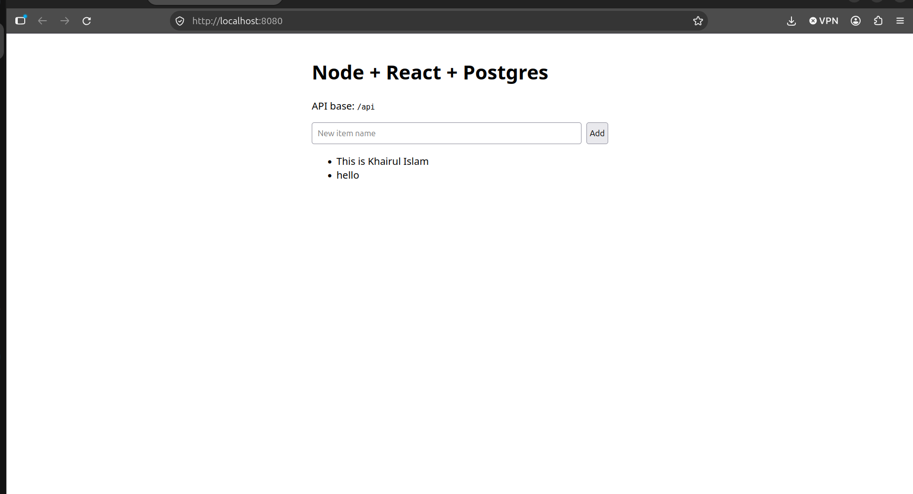 |
| Containers and health | 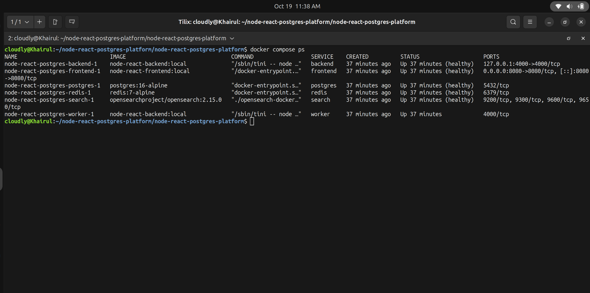 |

### Task 2: Kubernetes (`dev` namespace)
| | |
|---|---|
| All resources in `dev` | 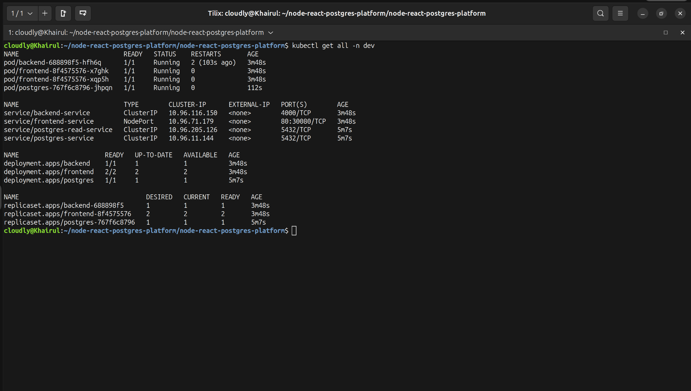 |
| App via NodePort 30080 | 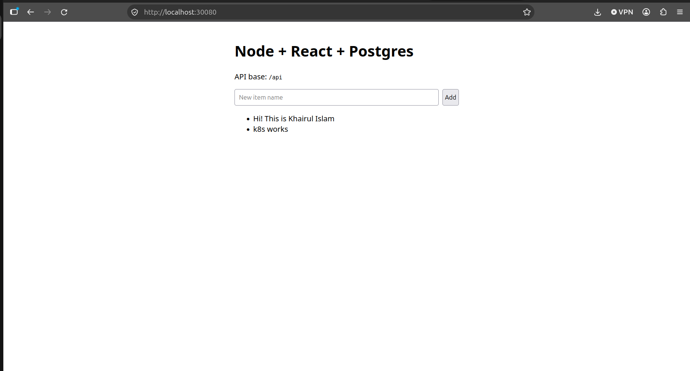 |

### Task 3: Ingress
| | |
|---|---|
| App at `http://node-react.local` | 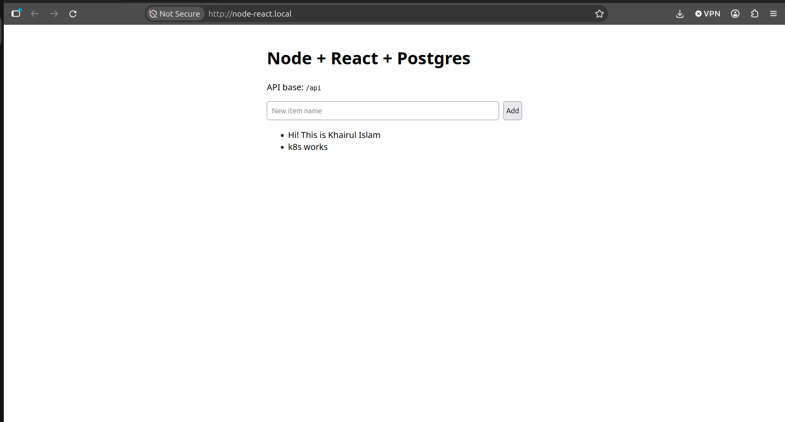 |
| Ingress objects | 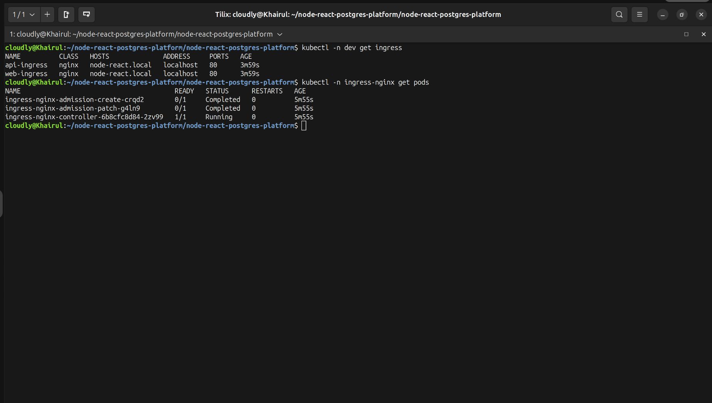 |

### Task 4: CI/CD (GitHub Actions)
Test and image build/push both pass on `master`. Deploy runs only when a self-hosted runner is configured.

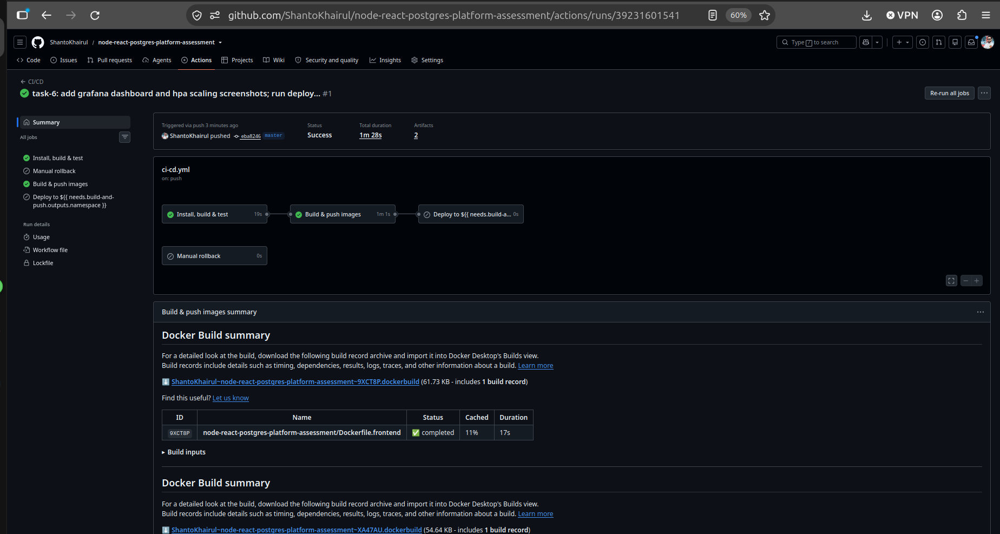

### Task 5: Platform services
| | |
|---|---|
| Redis, OpenSearch, BullMQ worker |  |
| NetworkPolicy isolation | 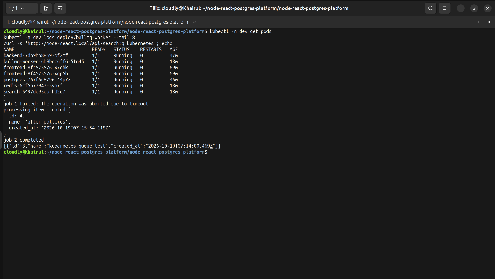 |

### Task 6: Observability and scaling
| | |
|---|---|
| Grafana backend dashboard | 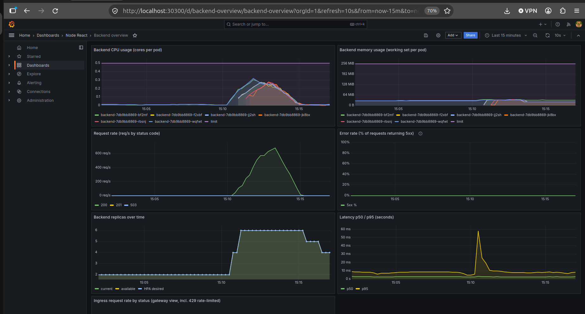 |
| HPA scaling under load | 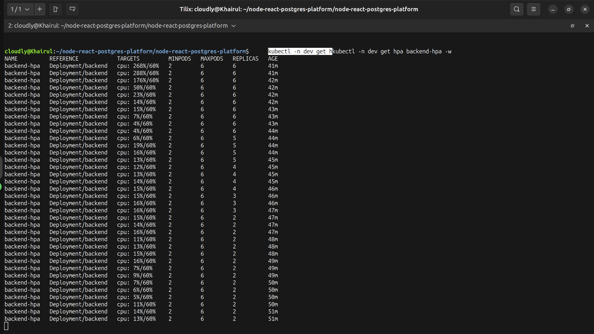 |
| Ingress rate limiting (100 requests: 68 x 200, 32 x 429) | 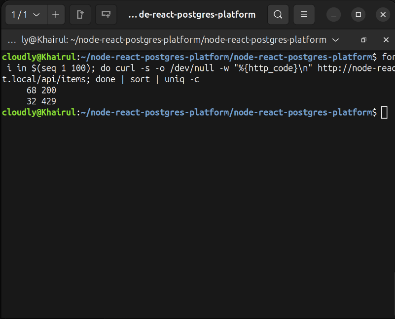 |
| Centralised logs in Loki (`{app="backend"}`) | 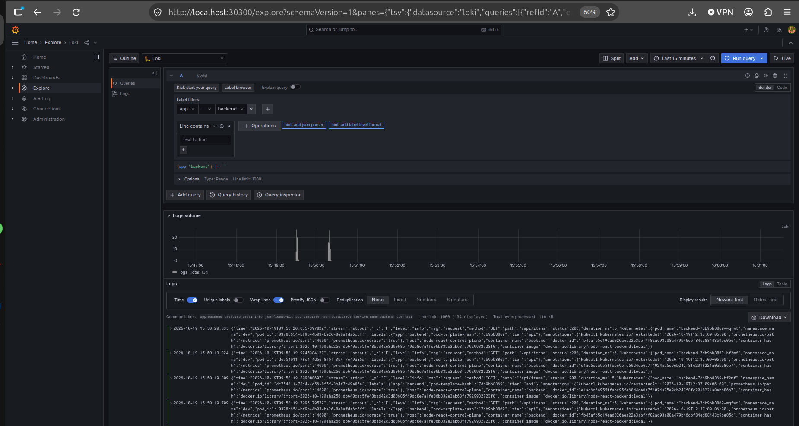 |
